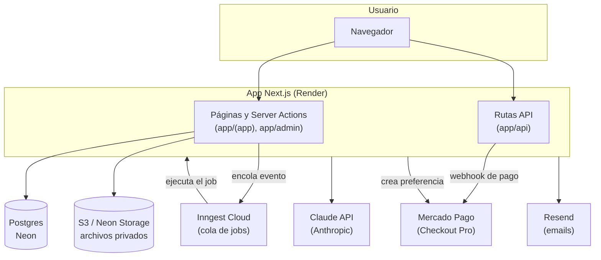
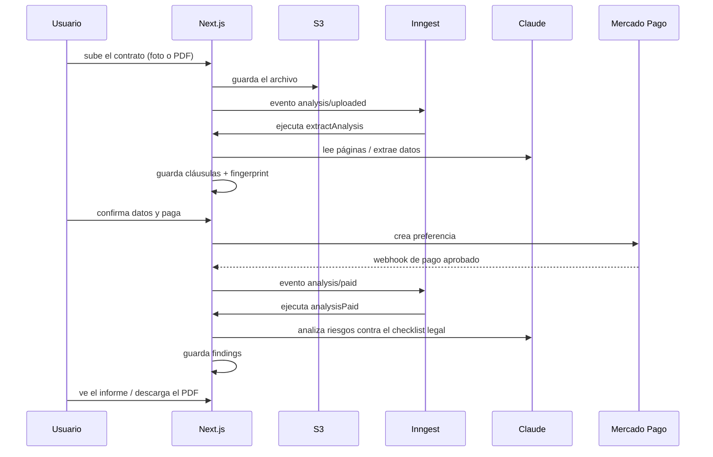

# Arquitectura

Mapa de los componentes que forman Contrato Claro y cómo se conectan entre sí. Para el estado de avance por etapa ver `progress.md`; para variables de entorno y despliegue, `deploy.md`.

## Vista general

La app es un solo servicio Next.js: no hay microservicios. Lo único que corre "aparte" son los jobs en segundo plano, que Inngest Cloud dispara contra esta misma app (`app/api/inngest`).

## Componentes

### 1. App Next.js (`app/`)

- **`app/(app)`**: todo lo que usa una persona logueada — subir un contrato, ver el estado, el informe, el re-chequeo, la cuenta.
- **`app/(public)`**: landing y páginas sin login.
- **`app/admin`**: panel interno (requiere `role = admin` en la tabla `user`, se activa a mano por SQL) con el costo de IA por análisis.
- **`app/api`**: endpoints que no son páginas — autenticación (Better Auth), el webhook de Mercado Pago, el receptor de eventos de Inngest, y `/health`.

Server Actions (`app/(app)/analisis/actions.ts`) son el punto de entrada para casi todo: subir archivos, confirmar datos, iniciar pago, subir la versión final del re-chequeo. Validan con Zod, chequean que el archivo sea del usuario dueño de la sesión, y encolan el evento correspondiente en Inngest.

### 2. Base de datos (Postgres / Neon + Drizzle)

Tablas principales (`db/schema.ts`):

| Tabla | Para qué |
|---|---|
| `user`, `session`, `account`, `verification` | Login (Better Auth) |
| `analyses` | Un análisis de contrato: estado, tipo, fechas |
| `documents`, `documentPages` | Los archivos subidos (original, recheck), página por página si son fotos |
| `clauses` | El contrato partido en cláusulas, resultado de la extracción |
| `findings` | Los hallazgos del análisis de riesgos por cláusula |
| `fingerprints` | Hash del archivo y del texto normalizado, para el re-chequeo |
| `payments`, `paymentEvents` | Pagos de Mercado Pago y los webhooks recibidos |
| `rechecks` | Re-chequeos: documento subido, resultado, cambios detectados |
| `aiUsage` | Tokens y costo de cada llamada a Claude, para el panel admin |
| `norms`, `normVersions`, `normChunks` | Reservadas para el RAG de normativa (etapa 5, todavía no implementada — hoy la ley vigente está embebida en el checklist) |
| `auditLog`, `rateLimit` | Auditoría y límite de intentos |

El acceso a datos pasa por `lib/db/scoped.ts`: funciones "scoped" a un `userId`, para que ninguna consulta pueda traer o modificar datos de otra persona por error.

### 3. Almacenamiento de archivos (`lib/storage/s3.ts`)

S3-compatible (Neon Storage). Todo es **privado**: la app sube y lee con credenciales propias, y entrega a cada usuario una URL firmada (presigned) de corta duración para subir su archivo o descargar su informe. Nada se sirve público directo desde el bucket.

### 4. Jobs en segundo plano (`jobs/`, vía Inngest Cloud)

La app nunca hace el trabajo pesado (leer un PDF, llamar a Claude, comparar documentos) en el mismo request del usuario. En cambio encola un evento y responde al toque; Inngest Cloud guarda la cola, reintenta si falla, y dispara la ejecución llamando a `app/api/inngest`.

| Job | Evento que lo dispara | Qué hace |
|---|---|---|
| `extractAnalysis` | `analysis/uploaded` | Lee el documento (texto, o fotos/PDF escaneado vía Claude), lo parte en cláusulas, calcula el fingerprint |
| `analysisPaid` | `analysis/paid` | Corre el análisis de riesgos con IA sobre el contrato ya pagado |
| `runRecheck` | `recheck/uploaded` | Lee la versión final subida y la compara contra la analizada (hash completo primero, si no cláusula por cláusula) |
| `purgeFiles` | — (cron) | Borra archivos vencidos de S3 |
| `hello` | — | Job de prueba, sin uso real |

`lib/extraction/read-with-ai.ts` concentra la lógica de "leer un documento" (texto nativo, o Claude si es foto / PDF escaneado) para que `extractAnalysis` y `runRecheck` no la dupliquen.

### 5. IA (Claude, `lib/ai/`)

- **`anthropic.ts`**: implementación real contra la API de Anthropic. Dos usos:
  - `readPages`: OCR de fotos o PDF escaneado → texto.
  - `extractFields` / `analyzeRisks`: extracción de datos clave y chequeo de riesgos, con salida estructurada (Zod) contra el checklist de `lib/analysis/checklists/rental-v1.ts`.
- **`mock.ts`**: simulador, usado solo en local/tests (**prohibido en producción**, regla del proyecto).
- **`provider.ts`**: decide cuál de los dos usar según el entorno.
- **`pricing.ts`** + tabla `aiUsage`: cada llamada registra tokens y costo en USD, para el panel `/admin`.
- Modelo: Claude Haiku 5.5, elegido por costo frente a Sonnet/Opus.

El checklist de riesgos (`lib/analysis/checklists/rental-v1.ts`) tiene la normativa argentina vigente (post DNU 70/2023) escrita a mano — no es RAG, es una lista de reglas fija que se le da a Claude como contexto en cada análisis.

### 6. Pagos (Mercado Pago, `lib/payments/`)

- **`mercadopago-api.ts`**: crea la preferencia de pago (Checkout Pro).
- **`app/api/webhooks/mercadopago/route.ts`** + **`webhook.ts`**: recibe la notificación de pago, valida la firma HMAC, y actualiza `payments`/`paymentEvents`.
- **`mock.ts`**: simulador local (igual que la IA, prohibido en producción).
- Dos secretos de firma distintos en juego: el de la cuenta real y el de la cuenta "vendedor de prueba" para pagos sandbox (ver `deploy.md`).

### 7. Autenticación (Better Auth, `lib/auth/`)

Magic link y email/password. Agrega el campo `role` a `user` para distinguir admins (se activa manualmente por SQL, nunca desde la app).

### 8. Email (`lib/email/`, Resend)

Envío de magic links y notificaciones (se envía vía Resend; en local usa Mailpit para no mandar mails reales).

### 9. Despliegue (Render)

Un único servicio web Next.js en Render. Migraciones de Drizzle corren al bootear la app (no dependen del Pre-Deploy Command pago de Render). El detalle completo de variables de entorno y servicios externos está en `deploy.md`.

## Flujo típico: un análisis pagado de punta a punta

## Lo que NO es parte de esta arquitectura (todavía)

- **RAG de normativa**: las tablas existen (`norms`, `normVersions`, `normChunks`) pero no hay ingesta ni búsqueda implementada. Decisión explícita: mantener la actualización de la ley a mano en el checklist hasta que haga falta más.
- **Microservicios separados** (por ejemplo un servicio en Go): evaluado y descartado — todo corre en la misma app Next.js, con Inngest para lo que necesita correr fuera del request.
